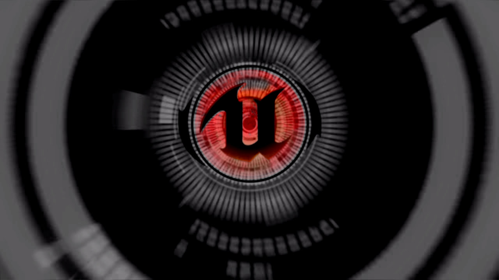
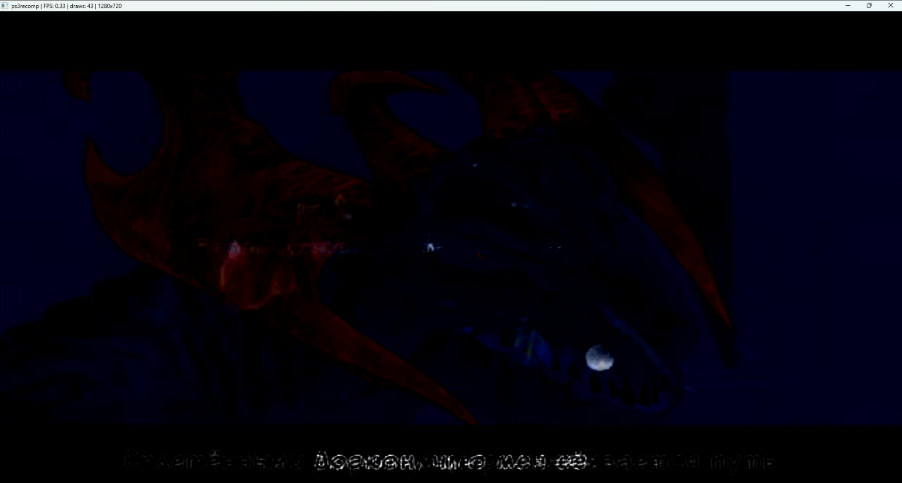

# Drakengard 3 — Native Windows Recompilation

An experimental native Windows port of Drakengard 3, based on static recompilation of the PS3 executable. The goal is to run as much game code natively as possible, with minimal PS3 compatibility machinery, using game files supplied by the user. The currently analyzed release is NPUB31251 v1.01.

## Current status

The native executable renders the Unreal intro and plays audio. The project includes a full PPU lift, 40 embedded SPU images, raw SPURS jobs, and 71 additional native functions for the streamed MultiStream DSP plugins. The DSP plugins are selected only when their runtime code matches the verified modules from the user's EBOOT.

**This is not yet a playable port.** Later movie playback can still drop to roughly 0.7 FPS, rendering has visible issues, and a working main menu, controls, and gameplay have not been confirmed. Some intro sections run at around 30 FPS; these measurements do not represent overall performance.

The latest implementation checkpoints are `3dabe93` (native log transport and shader pipeline fixes) and `14e61cb` (native DSP plugins). The latest build passed 22 portable tests and seven focused native checks, including a native/interpreter comparison of the DSP PIC initializer's registers and local store. This comparison does not cover every DSP function.

## Rendering progress

Screenshots from the experimental native Windows build. Intro frames are already visible, although rendering and performance still need work. These captures show intro playback; a working menu and gameplay have not yet been confirmed.

### Unreal Engine intro



### Intro scene



The scene capture shows the current dark image and subtitle artifacts, with approximately 0.33 FPS reported in the window title at the time of capture.

## Research and implementation notes

These documents record earlier milestones and investigations. Their historical blocker descriptions may have been superseded by later work.

- [Initial analysis](docs/FIRST_ANALYSIS.md): findings, hashes, and limitations of the supplied release.
- [Native resource boot](docs/RESOURCE_API_PROGRESS.md): PPU/SPU lifts, EDAT APIs, OVIS ABI, allocation tables, and cooked package loading.
- [SPURS queues](docs/SPURS_QUEUE_PROGRESS.md): real PPU/SPU queue records, image ID isolation, FIFO ordering, wraparound, and blocking producers.
- [SPU overlays](docs/SPU_OVERLAY_PROGRESS.md): interpreter fallback returns and audio EventFlag wakeups.
- [SPURS task identity](docs/SPURS_TASK_IDENTITY.md): task ownership, argument snapshots, and duplicate claims.
- [GPU FIFO](docs/GPU_FIFO_PROGRESS.md): preserving commands while a producer-owned FIFO segment is parked.
- [Memory reuse](docs/MEMORY_REUSE_PROGRESS.md): reuse of released kernel pages and native regression checks.
- [LFQueue initialization](docs/LFQUEUE_PROGRESS.md) and [LFQueue publication](docs/LFQUEUE_PUSH_PROGRESS.md): ANY2ANY initialization, real task publication, and SPU consumption.
- [First native image](docs/FIRST_NATIVE_IMAGE.md): the first verified native intro frame.
- [Handoff](docs/HANDOFF.md): development context and historical checkpoints.

## Quick start

Run from PowerShell in the project root:

```powershell
.\scripts\doctor.ps1
.\scripts\start-ghidra.ps1
```

Tool preparation and checks:

```powershell
.\scripts\bootstrap.ps1
.\scripts\build-spu-extension.ps1
.\scripts\build-runtime.cmd
.\scripts\check-toolchain.cmd
.\scripts\check-ghidra.ps1
.\.venv\Scripts\python.exe -m unittest discover -s tests -v
```

Bootstrap downloads official archives, records revisions and SHA-256 hashes in `reports/`, and checks published digests for binary releases. LLVM is extracted with 7-Zip without running its installer. Global PATH and Java settings are not modified.

Create the Python environment with `python -m venv .venv`, then install the toolkit requirements with `.\.venv\Scripts\python.exe -m pip install -r third_party\ps3recomp\tools\requirements.txt`. Installed versions are recorded in `reports/python-lock.txt`; that file can be passed to `pip install -r` when recreating the environment.

RPCS3 is available locally at `tools/rpcs3/rpcs3.exe` for reference runs. Firmware, accounts, licenses, and game files are not included. Install firmware according to RPCS3's official instructions and provide your own prepared game files before a reference run.

Building the game executable also requires the locally generated PPU and SPU sources. These are intentionally excluded from Git; a fresh clone alone is not sufficient to build or run the game.

## Directories

| Path | Purpose |
| --- | --- |
| `input/` | User-supplied files, read-only during analysis |
| `work/` | Working copies, Ghidra projects, loader/lifter output, and generated code |
| `reports/` | Tool versions, hashes, build logs, and check results |
| `third_party/` | External tool source snapshots and their licenses |
| `tools/` | Portable tools, archives, and Gradle cache |
| `build/` | Local build output |
| `docs/PORTING_PLAN.md` | Milestones, success criteria, and open questions |
| `docs/RESEARCH_LOG.md` | Observations and hypotheses |

The primary repository is [k1gs/Drakengard3Recompile](https://github.com/k1gs/Drakengard3Recompile), on branch `main`. The original [GitLab repository](https://gitlab.thebakerc.at/k1gs/drakengard-recompile) is retained as a separate remote.

`.gitignore` excludes local tools, working data, generated game code, crash dumps, and build output. `.gitattributes` defines line endings. The existing GitLab CI configuration runs portable intake/parser tests and requires a runner with container image support. The Windows runtime, Ghidra, and game are checked separately on the local machine.

Do not publish game images, DLC, licenses, keys, memory dumps, or generated game code. Review the files being published explicitly: ignore rules do not protect files already tracked by Git.

## Importing user-supplied game files

First confirm that the download has completed and been verified in the download client. Then run a one-time intake with a fresh report name:

```powershell
.\.venv\Scripts\python.exe scripts\inspect_input.py "PATH_TO_COMPLETED_IMAGE_OR_DIRECTORY" --download-complete --hash-all --out reports\intake-001.json
```

The script reads files, computes streaming SHA-256 hashes, identifies ELF/SELF/PKG files, and parses PARAM.SFO. It does not extract ISO images; a full file listing and metadata require a separate extraction into `work/`. It refuses to overwrite a report and detects size or modification-time changes while reading. Its output does not prove download completion or image authenticity.

Recompilation requires a valid plain ELF of the main executable and the game's file tree. For user-owned SELF files, use RPCS3's documented extraction/decryption workflow. Before lifting, inspect the executable's architecture, endianness, TOC, OPD, imports, PRX/SPRX libraries, and embedded SPU modules. See the research notes and porting plan for the project's existing analysis.
