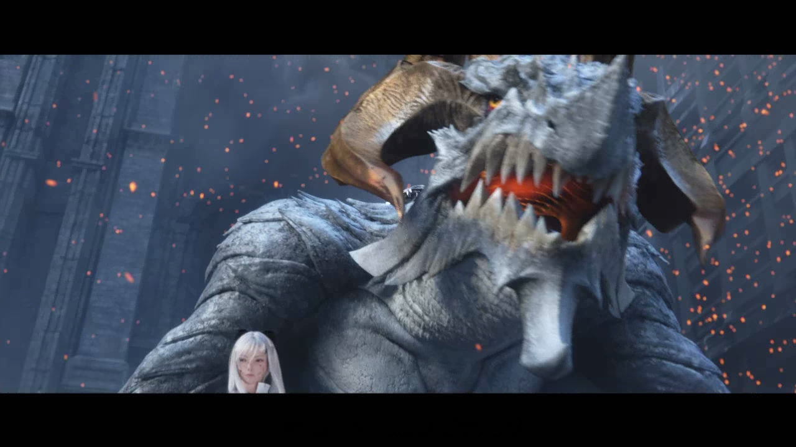
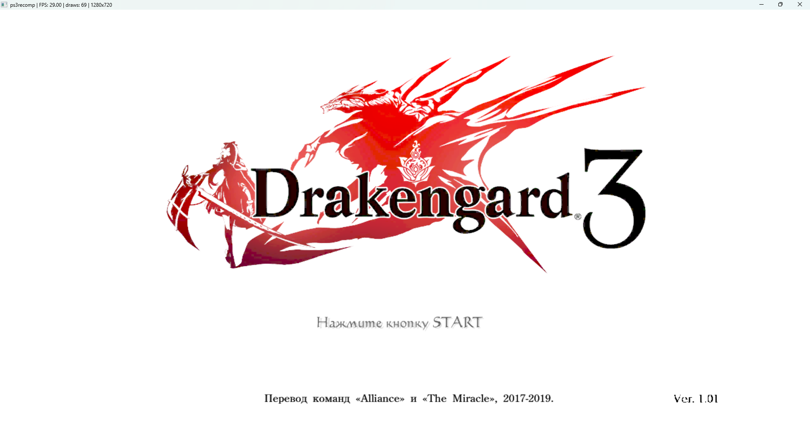

# Drakengard 3 — Native Windows Recompilation

An experimental native Windows port of Drakengard 3, based on static recompilation of the PS3 executable. The goal is to run as much game code natively as possible, with minimal PS3 compatibility machinery, using game files supplied by the user. The currently analyzed release is NPUB31251 v1.01.

## Current status

The native executable renders the Unreal intro and plays audio. The project includes a full PPU lift, 40 embedded SPU images, raw SPURS jobs, and 71 additional native functions for the streamed MultiStream DSP plugins. The DSP plugins are selected only when their runtime code matches the verified modules from the user's EBOOT.

**This is not yet a playable port.** Movie playback now runs at approximately 30 FPS on the tested machine. The title screen with the Start prompt has been reached and visually confirmed by the user. The menu still has overlapping images and flickering; menu navigation, gameplay, and Switch-mode controllers are not yet verified.

The latest build passed 25 portable tests and 19 native checks, including presentation boundaries and a native/interpreter comparison of the DSP PIC initializer's registers and local store. These checks do not establish full game compatibility.

## Rendering progress

Actual captures from the experimental native Windows build. Performance numbers describe these tested intro sections, not gameplay.

### Native movie playback



The movie now uses its actual YUV video textures. A screen-size heuristic previously replaced the luma texture with the previous rendered frame, causing persistent silhouettes and overlapping subtitles.

### Title screen



User-provided capture at approximately 29 FPS. The title screen is visible, but overlapping images and flickering in the menu remain unresolved.

## Test controls

Focus the game window before pressing keys. The keyboard is used when no XInput controller is connected. Pass `-KeyboardOnly` to the runner to select it explicitly, even when a controller is connected.

| Keyboard | Game action |
| --- | --- |
| Enter / Esc | Start; request a skip in skippable cutscenes |
| Space / Z | Cross / confirm |
| Backspace / X | Circle / back |
| Arrow keys | D-pad and left stick |
| A / S | Square / Triangle |
| Q / W | L1 / R1 |
| 1 / 2 | L2 / R2 |
| Tab | Select |

```powershell
.\scripts\run-game.ps1 -Run keyboard-test-001 -Seconds 300 -Interactive -KeyboardOnly
```

Choose a fresh Run ID each time. The test runner stops the game at the specified time limit. Cutscene skipping remains under the game's control; these keys send the real Start button, without bypassing game logic. An 8BitDo controller in Switch mode is not supported by the current Windows XInput backend; physical controller testing is pending.

## Quick start

Run from PowerShell in the project root:

```powershell
.\scripts\doctor.ps1
.\scripts\start-ghidra.ps1
```

Tool preparation and checks:

```powershell
.\scripts\bootstrap.ps1
.\scripts\build-spu-extension.ps1
.\scripts\build-runtime.cmd
.\scripts\check-toolchain.cmd
.\scripts\check-ghidra.ps1
.\.venv\Scripts\python.exe -m unittest discover -s tests -v
```

Bootstrap downloads official archives, records revisions and SHA-256 hashes in `reports/`, and checks published digests for binary releases. LLVM is extracted with 7-Zip without running its installer. Global PATH and Java settings are not modified.

Create the Python environment with `python -m venv .venv`, then install the toolkit requirements with `.\.venv\Scripts\python.exe -m pip install -r third_party\ps3recomp\tools\requirements.txt`. Installed versions are recorded in `reports/python-lock.txt`; that file can be passed to `pip install -r` when recreating the environment.

RPCS3 is available locally at `tools/rpcs3/rpcs3.exe` for reference runs. Firmware, accounts, licenses, and game files are not included. Install firmware according to RPCS3's official instructions and provide your own prepared game files before a reference run.

Building the game executable also requires the locally generated PPU and SPU sources. These are intentionally excluded from Git; a fresh clone alone is not sufficient to build or run the game.

## Directories

| Path | Purpose |
| --- | --- |
| `input/` | User-supplied files, read-only during analysis |
| `work/` | Working copies, Ghidra projects, loader/lifter output, and generated code |
| `reports/` | Tool versions, hashes, build logs, and check results |
| `third_party/` | External tool source snapshots and their licenses |
| `tools/` | Portable tools, archives, and Gradle cache |
| `build/` | Local build output |
| `docs/` | Local research notes and handoffs (not tracked in Git) |

The primary repository is [k1gs/Drakengard3Recompile](https://github.com/k1gs/Drakengard3Recompile), on branch `main`. The original [GitLab repository](https://gitlab.thebakerc.at/k1gs/drakengard-recompile) is retained as a separate remote.

`.gitignore` excludes local research notes, `CURRENT_STATE.md`, local tools, working data, generated game code, crash dumps, and build output. `.gitattributes` defines line endings. The existing GitLab CI configuration runs portable intake/parser tests and requires a runner with container image support. The Windows runtime, Ghidra, and game are checked separately on the local machine.

Do not publish game images, DLC, licenses, keys, memory dumps, or generated game code. Review the files being published explicitly: ignore rules do not protect files already tracked by Git.

## Importing user-supplied game files

First confirm that the download has completed and been verified in the download client. Then run a one-time intake with a fresh report name:

```powershell
.\.venv\Scripts\python.exe scripts\inspect_input.py "PATH_TO_COMPLETED_IMAGE_OR_DIRECTORY" --download-complete --hash-all --out reports\intake-001.json
```

The script reads files, computes streaming SHA-256 hashes, identifies ELF/SELF/PKG files, and parses PARAM.SFO. It does not extract ISO images; a full file listing and metadata require a separate extraction into `work/`. It refuses to overwrite a report and detects size or modification-time changes while reading. Its output does not prove download completion or image authenticity.

Recompilation requires a valid plain ELF of the main executable and the game's file tree. For user-owned SELF files, use RPCS3's documented extraction/decryption workflow. Before lifting, inspect the executable's architecture, endianness, TOC, OPD, imports, PRX/SPRX libraries, and embedded SPU modules.
